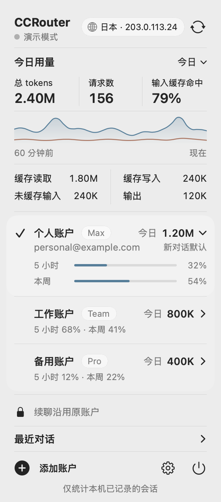
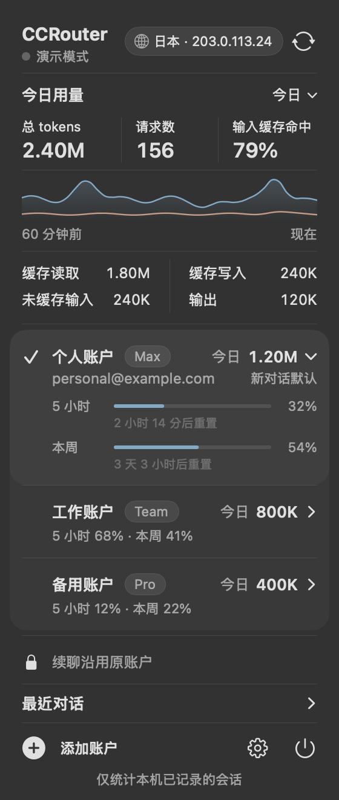

<p align="center"></p>

# CCRouter

**English** | [简体中文](README.zh-CN.md)

Use several Claude Code accounts without mixing them up. CCRouter pins every conversation to the account that started it, and shows usage and quota for all accounts in a native macOS menu bar panel. In the terminal, `ccrouter` works like `claude` and lets you pick the account first.

There is no proxy. CCRouter chooses the account's config directory and hands the terminal over to the official `claude` binary. Logins, account details and quota also come from the official CLI. CCRouter's only request of its own is an exit IP probe that carries no account information.

<p align="center">
  
  &nbsp;&nbsp;
  
</p>
<p align="center"><sub>Offscreen renders with demo data. On screen, the panel sits on the system popover material. The interface is in Simplified Chinese.</sub></p>

## Why CCRouter

- **Nothing in the request path.** CCRouter never relays model traffic or sees your prompts. It sets up the environment, then replaces itself with `claude` (`exec`). Your requests, streaming and errors are exactly what the official CLI produces.
- **Every account request comes from Claude Code.** CCRouter has no client for the Anthropic API and never reads OAuth tokens. Quota is asked of Claude Code itself (`claude -p /usage`, a local command with no model turn). The only request CCRouter sends to an Anthropic domain is the anonymous exit IP probe described under [Network requests](#network-requests).
- **Conversations stay on their account.** Each conversation ID is bound to one account. Resuming offers that account first, even after you change the default, so you don't lose the prompt cache or end up with a history split across accounts by accident. Moving it to another account is always an explicit choice.
- **Light on your machine.** No per-conversation helper process, no polling, no Electron or WebView. See the [measurements](#resource-usage).
- **Usage and quota at a glance.** Tokens for today, the last 7 days or all time, per account and in total, with cache hit rate and a one-hour trend. The 5-hour and weekly quota windows for every account, and the exit IP you're probing from.
- **Private by design.** The local database stores no tokens, prompts or conversation text. Conversation titles in the resume list are read from Claude's own transcripts when you open the list, and never saved.
- **Guards against common mistakes.** CCRouter refuses to start Claude on an account that has never logged in, and removes inherited API-key and token variables that would silently override the chosen account.

## Resource usage

| | Measured |
| --- | --- |
| Launcher time before handing off to `claude` | ~18 ms (median of 30 runs) |
| Processes left running per conversation | 0. The launcher becomes `claude` through `exec`. |
| Menu bar app, memory | ~48 MB physical footprint (the Activity Monitor figure) |
| Menu bar app, CPU | ~0.01% with the panel closed; ~0.05% while Claude sessions are writing transcripts |
| Disk | 31 MB app bundle (launcher 8 MB, menu bar app 23 MB) |
| Background work | One FSEvents stream for all accounts. Transcripts are read incrementally by byte offset. Nothing is redrawn while the panel is closed. |
| Quota refresh | Only when the panel opens and the reading is over 5 minutes old: one `claude -p /usage` per account, about 2 s, no model turn and no tokens |

Measured on an Apple Silicon MacBook Pro (M1 Pro) running macOS 15.7, with two accounts and a few hundred megabytes of existing transcripts. Details and method: [docs/verification.md](docs/verification.md).

## Requirements

- macOS 13 or later. The prebuilt app is for Apple Silicon. Tested on macOS 15.7.
- [Claude Code](https://code.claude.com/docs/en/setup) installed, and Claude subscription accounts (Pro, Max or Team) that sign in with `claude auth login`.
- To build: Go 1.27.3 or later, and Xcode or the Xcode Command Line Tools.

## Install

### Download

Download `CCRouter-<version>-macos-arm64.zip` from [Releases](https://github.com/HiderX/CCRouter/releases), unzip it, and move `CCRouter.app` to `/Applications`. The prebuilt app is for Apple Silicon.

The app isn't notarized, which needs a paid Apple Developer ID, so macOS blocks it the first time. Clear the download quarantine once, then open it:

```sh
xattr -dr com.apple.quarantine /Applications/CCRouter.app
open /Applications/CCRouter.app
```

To check the download first, compare it with the `.sha256` file from the release: `shasum -a 256 -c CCRouter-<version>-macos-arm64.zip.sha256`.

Put the launcher on your `PATH` so you can run `ccrouter` like `claude`:

```sh
ln -s /Applications/CCRouter.app/Contents/MacOS/ccrouter ~/.local/bin/ccrouter
```

Any directory on your `PATH` works.

### Build from source

```sh
git clone https://github.com/HiderX/CCRouter.git
cd CCRouter
make app
open dist/CCRouter.app
ln -s "$PWD/dist/CCRouter.app/Contents/MacOS/ccrouter" ~/.local/bin/ccrouter
```

A local build is signed ad hoc, which is enough on the Mac that built it, and the link follows later `make app` builds. `make release` produces the zip and checksum published on the Releases page.

## Quick start

1. **Add accounts.** In the menu bar panel, click 添加账户 (Add account), name it, and finish the official Claude login in Terminal. Each account added this way gets its own config directory. To register the login you already have in `~/.claude`, use 导入当前 Claude 账户 (Import current Claude account) in the gear menu.
2. **Start a conversation.** Run `ccrouter` in a project folder. Choose an account. The default one is preselected, so pressing Enter is enough. Claude starts as usual.
3. **Come back later.** Run `ccrouter --resume` anywhere. Pick a conversation from any account, or type to filter. CCRouter then asks which account continues it, with the one it last ran on preselected, so Enter keeps it. It changes to that conversation's project folder and resumes it.

## Terminal usage

```sh
ccrouter                          # new conversation here; choose the account first
ccrouter --resume                 # choose a conversation from every account and resume it
ccrouter --resume "weekly report" # open the list with a search term
ccrouter -c                       # continue the latest conversation in this folder
ccrouter --account Work           # skip the choice and use this account
ccrouter -c --switch-account Spare # carry on under another account (the cache starts cold)
ccrouter --model opus "fix login" # everything else goes to claude unchanged
```

The account list shows each account's email and marks the default and any account that isn't logged in. Use the arrow keys or type the number. The conversation list shows each conversation's title, project, last activity and account. Titles are the ones Claude generates, or the first prompt when there is none.

Resuming (`--resume`, with or without an ID, and `-c`) then asks which account continues the conversation. Each account shows its current quota; the one the conversation last ran on is marked 上次使用 (last used) and preselected. Picking another account switches the conversation to it, and the prompt cache starts cold. With automatic scheduling, when the conversation's account has reached its threshold, the scheduler's pick is marked 自动调度推荐 (suggested) and preselected instead. `--account` or `--switch-account` skips the question.

With automatic scheduling on (see Automatic scheduling under [How it works](#how-it-works)), the account list for a new conversation preselects the strategy's pick, marked 自动调度推荐 (suggested), so Enter takes it and the launcher says why. Each account shows its current quota, and you can pick any other. In scripts and pipes the strategy picks without asking. `--account` still chooses directly.

The lists only appear in an interactive terminal. In scripts, pipes and `-p` (print) mode, a new conversation uses the default account (or the strategy's pick, with automatic scheduling), and `--resume` needs a full conversation ID. Claude's own management commands, such as `mcp`, `doctor` and `update`, don't go through CCRouter. Run them with `claude`.

Other commands:

| Command | What it does |
| --- | --- |
| `ccrouter gui` | Open the menu bar app |
| `ccrouter run [args]` | Start without asking, on the default account, the scheduler's pick, or `--account` |
| `ccrouter account list` | List accounts (`*` marks the default) |
| `ccrouter account add NAME` | Add an account with its own config directory and log in |
| `ccrouter account import [--name NAME] [--profile DIR]` | Register an existing config directory, `~/.claude` by default |
| `ccrouter account use NAME` | Set the default account for new conversations |
| `ccrouter account login NAME` | Log in again |
| `ccrouter account rename NAME NEW` | Change the display name only |
| `ccrouter schedule` | Show the scheduling mode, each account's threshold and the next account |
| `ccrouter schedule manual` or `auto [最优\|轮询\|5h]` | Switch between manual and automatic scheduling, and pick the strategy |
| `ccrouter schedule threshold NAME PERCENT` | Set an account's threshold (50–100, in steps of 5) |
| `ccrouter schedule include\|exclude NAME` | Let an account take part in automatic scheduling, or leave it out |
| `ccrouter schedule resume on\|off` | Whether a resume switches accounts at the threshold |
| `ccrouter sessions` | List conversations and their accounts |
| `ccrouter stats [--account NAME] [--days 1\|7\|0]` | Token totals as JSON (`--days 0` for all time) |
| `ccrouter quota` | Quota windows for every account |
| `ccrouter ip` | The probed exit IP and its country |
| `ccrouter scan` | Index transcripts now |
| `ccrouter demo` | Preview the panel with demo data, without reading any credentials |

## Menu bar panel

- **Usage:** total tokens, requests and input cache hit rate, a one-hour trend, and a breakdown of cache reads, cache writes, uncached input and output. Click 今日 (Today) to cycle through today, the last 7 days and all time.
- **Accounts:** click anywhere on an account to show its email and quota bars, each with the time left until it resets. On an expanded account, 设为默认 (Set as default) makes it the default for new conversations. The ✓ marks the current default. With automatic scheduling, a blue arrow and 下一个 (Next) mark the account the next conversation gets instead, accounts that reached their threshold, aren't logged in or don't take part are labeled too, and a tick on an expanded account's quota bars marks its threshold.
- **Exit IP:** the address and country your traffic leaves from. Click to copy.
- **账户调度 (Account scheduling):** with more than one account, the 续聊沿用原账户 row becomes this, and opens in place to switch between manual and automatic. Manual works as before: new conversations use the default account, resumes keep theirs. Automatic offers three strategies, each showing the account it would pick right now, then which accounts take part, each account's threshold, and whether a resume switches at the threshold. The last line says why the next conversation goes where it goes.
- **最近对话 (Recent conversations):** opens in place. Click a conversation to resume it in Terminal on its own account, or where automatic scheduling moves it; its account label then reads "old → new". Click the account label to continue on another logged-in account, or to keep the conversation's own. 新对话… (New conversation) starts one in a folder you choose.
- While account scheduling or recent conversations is open, the usage section steps aside, and opening one section closes the others, so the panel fits the screen.
- **Gear menu:** import `~/.claude`, rename an account, log in again, refresh account details, or open the data folder.

## How it works

- **One config directory per account.** This is the [method Claude Code documents](https://code.claude.com/docs/en/authentication) for staying signed in to several accounts. Claude keys its Keychain entry to the directory, so logins never overwrite each other. An imported `~/.claude` keeps its original Keychain entry.
- **One copy of each conversation.** Every added account links `projects`, `file-history` and `session-env` to the same folders in `~/.claude`, so any account can resume any conversation. Credentials, settings and `.claude.json` stay per account. The first time an account launches, the conversations it recorded on its own are folded into `~/.claude` by rename, with no data copied. A file whose name is taken with different content is left alone, and that folder stays unshared. Folding waits until no Claude of that account is running.
- **Binding before launch.** A new conversation gets an ID up front (`--session-id`), recorded with its account. A resume looks the ID up. A binding only moves to the account that actually runs the conversation (next item), and two launchers racing can't scramble it.
- **Switching accounts on purpose.** `--switch-account` (with `--resume` or `-c`) only moves the conversation's binding to the other account. No conversation file is read or written. The ID stays the same, and later resumes use the new account, where the prompt cache now is. The first request after the switch rebuilds the prompt cache in full. Opening another account's conversation with `/resume` inside Claude also moves the binding to the account you are in. Usage from before the switch stays with the old account; usage after it counts toward the new one.
- **Automatic scheduling.** The decision is made at launch, from the readings Claude cached, so a launch never waits for a refresh; a window past its reset counts as empty. While automatic scheduling is on, the menu bar app refreshes quotas in the background every 10 minutes. Each account has its own threshold (95% by default). Once either window reaches it, the account counts as full and every strategy skips it.
  - **5h/7d 最优 (5h/7d optimal):** quota that lapses first goes first. Weekly quota is what an account has to spend; a 5-hour window only limits how fast it goes, so weekly quota leads the score: weekly headroom per remaining day, against an even pace through the week. Above that pace the quota would lapse at the reset, so the account goes first; below it the account is running ahead and waits. The 5-hour window can at most double the score: a running window counts for more the closer it is to its reset, a window not yet running adds nothing because it loses nothing, less than half its headroom left lowers the score in proportion, and a window under 30 minutes from its reset counts as reset, since there is no time left to spend it.
  - **轮询 (Round robin):** the next usable account after the one assigned last, in account order.
  - **5h 最大利用 (5-hour max):** only the 5-hour window counts. The running window that resets first goes first; with no window running, the one with the most headroom.

  A resume moves to the strategy's pick only when switching on resume is on and the conversation's account takes part and has reached its threshold. `--account` and `--switch-account` always win. With no usable account, a new conversation uses the default account.
- **A clean environment.** The launcher removes `ANTHROPIC_API_KEY`, `ANTHROPIC_AUTH_TOKEN`, `CLAUDE_CODE_OAUTH_TOKEN` and similar variables, and refuses settings that would override the account, such as `apiKeyHelper`. Your network and proxy settings stay as they are.
- **First-run setup.** `claude auth login` saves credentials but leaves Claude's first-run setup pending, so the next interactive start would ask you to log in again. After a login through CCRouter, and before starting an account that is logged in but was never set up, CCRouter sets `hasCompletedOnboarding` and `lastOnboardingVersion` in that account's `.claude.json`. Nothing else in the file changes, and `~/.claude` is left alone.
- **Quota through Claude Code.** `claude -p /usage` runs in the account's environment with no tools, MCP servers or settings sources, and saves no session. Claude refreshes its login under its own lock, queries usage, and caches the answer as `cachedUsageUtilization` in the account's `.claude.json`. CCRouter reads that cache, and only if it belongs to the account logged in there. The approach follows [CC Switch](https://github.com/farion1231/cc-switch).
- **Usage indexing.** A single FSEvents stream watches the accounts' `projects` folders. New lines are read from the last byte offset, and each record counts toward the account running the conversation at the time (from each account's `sessions` registry), or else its binding, and a message ID is counted once. A half-written line waits for the next event.

## Network requests

Everything to do with an account is done by the official `claude` CLI, in the account's own environment: `claude auth login`, `claude auth status`, and `claude -p /usage` for quota.

CCRouter's own requests are limited to the exit IP probe, and it sends no telemetry:

| Destination | When | Why |
| --- | --- | --- |
| `api.anthropic.com/cdn-cgi/trace` | When the panel opens, at most once a minute, and at once on refresh | Exit IP and its country |

This is Cloudflare's diagnostics page. The request goes to an Anthropic domain, but Cloudflare answers it itself, and it carries no cookies, tokens or account information. It is used because Claude Code talks to the same host, so proxy rules route the two alike.

`claude -p /usage`, for quota, runs when the panel opens, and with automatic scheduling on also every 10 minutes in the background, at most every 5 minutes per account.

A proxy that routes by process or balances load may still send the probe and Claude out differently, so the exit IP is a hint, not proof.

## Data and privacy

Data lives in `~/Library/Application Support/CCRouter`. Set `CCROUTER_HOME` to move it, and `CCROUTER_CLAUDE` to use a specific `claude` binary.

```text
CCRouter/
  state.db    accounts, conversation bindings, token counts, cached exit IP
  profiles/   config directories of accounts added through CCRouter
  menu.lock   keeps one menu bar app running
```

`state.db` holds no tokens, prompts or conversation text. Claude itself writes credentials to the Keychain or the config directory, and CCRouter never reads them: before a launch it only checks that the Keychain entry exists. Each added account has its own Claude settings, plugins and prompt history; conversation records are shared.

## Limitations

- The menu bar app is macOS only. The launcher and indexer also compile for Linux and Windows (SQLite needs cgo and a C toolchain for the target), but haven't been tested there.
- The interface is in Simplified Chinese.
- Token counts come from local transcripts. They don't include other machines or requests without recorded usage, so they are not a bill.
- Plain `claude` and sessions started by an IDE don't go through CCRouter's account selection.
- In an account added through CCRouter, Claude asks once per project folder whether you trust it. Claude keeps this per config directory.
- Liquid Glass on macOS 26 hasn't been checked on real hardware yet.
- Builds are signed ad hoc and not notarized, so a downloaded app needs its quarantine cleared once (see [Download](#download)).

## Development

```sh
make test                                   # unit and integration tests, with the race detector
go vet ./...
dist/ccrouter demo                          # panel with demo data, isolated from your accounts
dist/ccrouter demo --smoke dist/ui-smoke    # click through the real AppKit controls, export screenshots and a performance sample
make icon                                   # rebuild the app icon from designs/icon/ccrouter.png
```

```text
cmd/ccrouter/        launcher and command line
cmd/ccrouter-tray/   menu bar app
internal/schedule/   automatic scheduling: strategies, thresholds, resume switching
internal/session/    launch plan, account environment, login and setup checks
internal/store/      SQLite store and conversation bindings
internal/usage/      incremental transcript indexing, file events, conversation titles
internal/status/     quota through claude -p /usage, exit IP
internal/icon/       abstract spider lily for the menu bar, drawn in code
internal/pick/       interactive terminal lists
internal/ui/         AppKit interface written in Go
tools/icongen/       renders the artwork into packaging/CCRouter.icns
third_party/darwinkit/  pinned DarwinKit with compatibility fixes
```

The interface calls AppKit through [DarwinKit](https://github.com/progrium/darwinkit). The pinned copy includes the fix for a libffi callback lifetime crash on Go 1.25 and later ([issue #286](https://github.com/progrium/darwinkit/issues/286), [PR #289](https://github.com/progrium/darwinkit/pull/289)) and two small bridge fixes, listed in [CCROUTER_PATCHES.md](third_party/darwinkit/CCROUTER_PATCHES.md).

## Disclaimer

CCRouter is an independent project. It is not affiliated with or endorsed by Anthropic. Claude and Claude Code are trademarks of Anthropic. CCRouter doesn't change accounts on its own by default. Automatic scheduling is optional and off until you turn it on; before you do, check that it fits the terms of each account's plan.

## Acknowledgement

Thanks to the [LinuxDo](https://linux.do/) community for its feedback, deployment experience, and discussions that helped improve the user experience.

## License

[MIT](LICENSE). The bundled DarwinKit keeps its own [MIT license](third_party/darwinkit/LICENSE).
