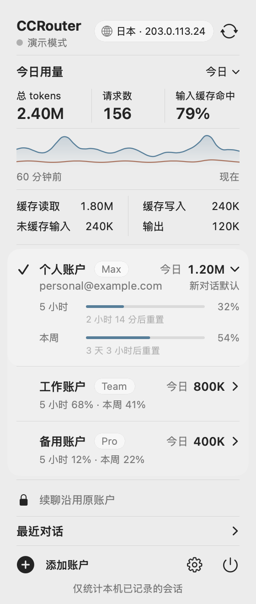
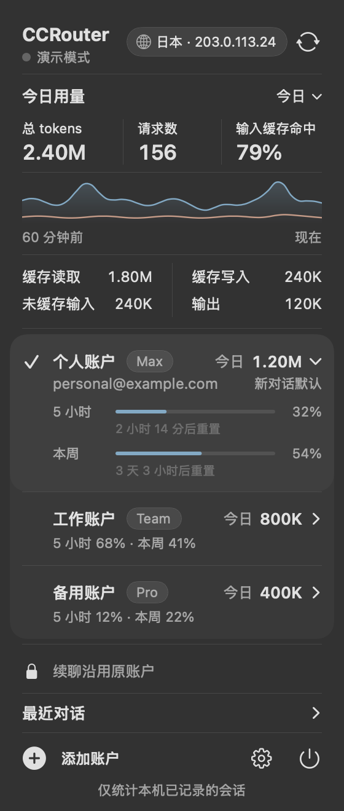

<p align="center"></p>

# CCRouter

[English](README.md) | **简体中文**

同时使用多个 Claude Code 账户，又不会把它们混在一起。CCRouter 把每个对话固定在创建它的账户上，并在原生 macOS 菜单栏面板里显示所有账户的用量和额度。在终端里，`ccrouter` 的用法和 `claude` 一样，只是会先让你选择账户。

没有反向代理，CCRouter 自己也从不与 Anthropic 通信。它只负责选好账户的配置目录，然后把终端交给官方的 `claude`。登录、账户资料和额度同样都来自官方 CLI。

<p align="center">
  
  &nbsp;&nbsp;
  
</p>
<p align="center"><sub>使用演示数据的离屏渲染。实际在屏幕上，面板底下是系统弹出面板的材质。</sub></p>

## 为什么用 CCRouter

- **不经手任何请求**。CCRouter 不转发模型流量，也看不到你的提示词。它只准备好运行环境，然后通过 `exec` 把自己替换成 `claude`。请求、流式输出和报错都和官方 CLI 完全一致。
- **发往 Anthropic 的每个请求都来自 Claude Code**。CCRouter 没有连接 Anthropic 的 HTTP 代码，也从不读取 OAuth token。额度由 Claude Code 自己查询（`claude -p /usage`，一条不调用模型的本地命令），所以 Anthropic 看到的始终是官方客户端。
- **对话始终留在原账户**。每个对话 ID 只绑定一个账户。恢复时总是用这个账户，即使你之后改了默认账户也一样，因此不会丢失提示词缓存，也不会把一段历史拆散到不同账户里。用其他账户恢复会被拒绝。
- **几乎不占资源**。每个对话不额外留下进程，不轮询，不用 Electron 或 WebView。见下方[实测数据](#资源占用)。
- **用量和额度一目了然**。今日、近 7 天或全部的 token 用量，分账户和合计，附带缓存命中率和最近一小时趋势。每个账户的 5 小时和每周额度窗口，以及当前探测到的出口 IP。
- **从设计上保护隐私**。本地数据库不保存 token、提示词或对话正文。恢复列表里的对话标题在打开列表时从 Claude 自己的对话记录读取，从不保存。
- **防止常见失误**。账户从未登录过时，CCRouter 拒绝启动 Claude；会移除继承来的 API key 和 token 环境变量，避免它们悄悄顶替所选账户。

## 资源占用

| | 实测 |
| --- | --- |
| 启动器交给 `claude` 之前的耗时 | 约 18 ms（30 次的中位数） |
| 每个对话额外留下的进程 | 0 个。启动器通过 `exec` 直接变成 `claude`。 |
| 菜单栏应用的内存 | 约 48 MB 物理内存（活动监视器显示的口径） |
| 菜单栏应用的 CPU | 面板关闭时约 0.01%；Claude 会话持续写入对话记录时约 0.05% |
| 磁盘 | 应用包 31 MB（启动器 8 MB，菜单栏应用 23 MB） |
| 后台工作 | 所有账户共用一个 FSEvents 事件流；对话记录按字节偏移增量读取；面板关闭时不重绘 |
| 额度刷新 | 只在打开面板、且读数已超过 5 分钟时进行：每个账户运行一次 `claude -p /usage`，约 2 秒，不调用模型、不消耗 token |

测量环境：Apple Silicon MacBook Pro（M1 Pro），macOS 15.7，两个账户，已有几百 MB 的对话记录。方法和细节见 [docs/verification.md](docs/verification.md)。

## 系统要求

- 需要 macOS 13 或更高版本。预编译版本适用于 Apple Silicon。已在 macOS 15.7 上测试。
- 已安装 [Claude Code](https://code.claude.com/docs/en/setup)，并使用通过 `claude auth login` 登录的 Claude 订阅账户（Pro、Max 或 Team）。
- 构建需要 Go 1.27.3 或更高版本，以及 Xcode 或 Xcode Command Line Tools。

## 安装

### 下载

从 [Releases](https://github.com/HiderX/CCRouter/releases) 下载 `CCRouter-<版本>-macos-arm64.zip`，解压后把 `CCRouter.app` 移到「应用程序」文件夹。预编译版本适用于 Apple Silicon。

应用没有经过公证（公证需要付费的 Apple Developer ID），所以第一次打开时会被 macOS 拦下。先清除一次下载隔离标记，再打开：

```sh
xattr -dr com.apple.quarantine /Applications/CCRouter.app
open /Applications/CCRouter.app
```

如果想先校验下载的文件，可以用发布页里的 `.sha256` 文件比对：`shasum -a 256 -c CCRouter-<版本>-macos-arm64.zip.sha256`。

把启动器放到 `PATH` 上，就可以像 `claude` 一样使用 `ccrouter`：

```sh
ln -s /Applications/CCRouter.app/Contents/MacOS/ccrouter ~/.local/bin/ccrouter
```

任何在 `PATH` 里的目录都可以。

### 从源码构建

```sh
git clone https://github.com/HiderX/CCRouter.git
cd CCRouter
make app
open dist/CCRouter.app
ln -s "$PWD/dist/CCRouter.app/Contents/MacOS/ccrouter" ~/.local/bin/ccrouter
```

本地构建使用 ad-hoc 签名，在构建它的那台 Mac 上使用足够了；之后重新 `make app`，链接会自动指向新版本。`make release` 会生成发布页上的 zip 和校验文件。

## 快速开始

1. **添加账户**。在菜单栏面板点「添加账户」，起个名字，然后在终端里完成 Claude 官方登录。通过这种方式添加的账户各自有独立的配置目录。如果想登记 `~/.claude` 里已有的登录，在齿轮菜单里选「导入当前 Claude 账户」。
2. **开始对话**。在项目目录里运行 `ccrouter`，选择账户。默认账户已经预选，直接回车即可。之后 Claude 照常启动。
3. **稍后继续**。在任意目录运行 `ccrouter --resume`，从所有账户的对话中挑一个，也可以输入关键字筛选。CCRouter 会进入该对话的项目目录，用它原来的账户恢复。

## 终端用法

```sh
ccrouter                          # 在当前目录开新对话，先选择账户
ccrouter --resume                 # 从所有账户的对话中选择并恢复
ccrouter --resume 周报            # 带搜索词打开列表
ccrouter -c                       # 继续当前目录最近的对话
ccrouter --account 工作           # 跳过选择，直接用这个账户
ccrouter --model opus "修复登录"  # 其他参数原样交给 claude
```

账户列表会显示每个账户的邮箱，并标出默认账户和未登录的账户，可以用方向键或直接按数字选择。对话列表显示每个对话的标题、项目、最近活动时间和账户。标题是 Claude 自动生成的；没有标题时显示第一句提问。

列表只在交互式终端里出现。在脚本、管道和 `-p`（打印）模式下，新对话直接使用默认账户，`--resume` 需要完整的对话 ID。`mcp`、`doctor`、`update` 等 Claude 自己的管理命令不经过 CCRouter，请直接用 `claude` 运行。

其他命令：

| 命令 | 作用 |
| --- | --- |
| `ccrouter gui` | 打开菜单栏应用 |
| `ccrouter run [参数]` | 不询问，直接用默认账户或 `--account` 指定的账户启动 |
| `ccrouter account list` | 列出账户（`*` 表示默认） |
| `ccrouter account add 名称` | 新建使用独立配置目录的账户并登录 |
| `ccrouter account import [--name 名称] [--profile 目录]` | 登记已有的配置目录，默认是 `~/.claude` |
| `ccrouter account use 名称` | 设置新对话的默认账户 |
| `ccrouter account login 名称` | 重新登录 |
| `ccrouter account rename 名称 新名称` | 只修改显示名称 |
| `ccrouter sessions` | 列出对话及其账户 |
| `ccrouter stats [--account 名称] [--days 1\|7\|0]` | 以 JSON 输出 token 统计（`--days 0` 表示全部） |
| `ccrouter quota` | 所有账户的额度窗口 |
| `ccrouter ip` | 探测到的出口 IP 和所在国家/地区 |
| `ccrouter scan` | 立即索引对话记录 |
| `ccrouter demo` | 用演示数据预览面板，不读取任何凭据 |

## 菜单栏面板

- **用量**：总 tokens、请求数和输入缓存命中率，最近一小时的趋势，以及缓存读取、缓存写入、未缓存输入、输出四项明细。点「今日」可在今日、近 7 天和全部之间切换。
- **账户**：点击账户的任意位置，展开它的邮箱和额度条，每条额度下方显示距离重置还有多久。在展开的账户上点「设为默认」，它就成为新对话的默认账户；✓ 标出当前的默认账户。
- **出口 IP**：流量出口的地址和国家/地区，点击即可复制。
- **最近对话**：在终端里用原账户恢复最近的对话，或者选择「新对话…」并指定项目目录。
- **齿轮菜单**：导入 `~/.claude`、重命名账户、重新登录、刷新账户资料，或打开数据目录。

## 工作原理

- **每个账户一个配置目录**。这是 [Claude Code 文档](https://code.claude.com/docs/en/authentication)中同时保持多个账户登录的方法。Claude 按目录区分钥匙串条目，所以各账户的登录互不覆盖。导入的 `~/.claude` 保留它原来的钥匙串条目。
- **启动前先绑定**。新对话事先分配好 ID（`--session-id`），并与账户一起记录；恢复时按 ID 查找。绑定永远不会在账户之间转移，即使两个启动器同时运行也一样。
- **干净的环境**。启动器会移除 `ANTHROPIC_API_KEY`、`ANTHROPIC_AUTH_TOKEN`、`CLAUDE_CODE_OAUTH_TOKEN` 等变量，并拒绝 `apiKeyHelper` 这类会顶替账户的设置。网络和代理设置保持不变。
- **首次引导**。`claude auth login` 只保存凭据，不会把 Claude 的首次引导标记为完成，下一次交互启动时又会要求你登录。所以通过 CCRouter 登录成功后，以及启动一个已登录但从未完成引导的账户之前，CCRouter 会在该账户的 `.claude.json` 中写入 `hasCompletedOnboarding` 和 `lastOnboardingVersion`。文件里的其他内容不变，`~/.claude` 也不受影响。
- **额度经由 Claude Code**。`claude -p /usage` 在该账户的环境中运行，不加载工具、MCP 服务器和任何设置来源，也不保存会话。Claude 用自己的锁刷新登录、查询用量，并把结果以 `cachedUsageUtilization` 缓存到该账户的 `.claude.json`。CCRouter 只读取这份缓存，而且只认属于该目录当前登录账户的缓存。这个做法参考了 [CC Switch](https://github.com/farion1231/cc-switch)。
- **用量索引**。一个 FSEvents 事件流监听所有账户的 `projects` 目录。新内容从上次的字节偏移处读起，记录按账户和消息 ID 去重；写到一半的行留到下一次事件再读。

## 网络请求

CCRouter 从不连接 Anthropic。所有与 Anthropic 相关的操作都由官方 `claude` CLI 在该账户自己的环境中完成：`claude auth login`、`claude auth status`，以及查询额度的 `claude -p /usage`。

CCRouter 自己发出的请求只有出口 IP 探测，不发送任何遥测数据：

| 目标 | 时机 | 用途 |
| --- | --- | --- |
| `api.ipify.org` | 打开面板时；最多每 15 分钟一次 | 出口 IP |
| `ipinfo.io/<ip>/country` | 发现新的 IP 后 | 该 IP 所在国家/地区；失败时只显示 IP |

代理的分流规则可能让这些探测与 Claude 自己的请求走不同的出口，所以出口 IP 只是参考，不能作为证明。

## 数据与隐私

数据保存在 `~/Library/Application Support/CCRouter`。可以用 `CCROUTER_HOME` 换一个位置，用 `CCROUTER_CLAUDE` 指定 `claude` 可执行文件。

```text
CCRouter/
  state.db    账户、对话绑定、token 统计、缓存的出口 IP
  profiles/   通过 CCRouter 添加的账户的配置目录
  menu.lock   保证只运行一个菜单栏应用
```

`state.db` 不保存 token、提示词或对话正文。凭据由 Claude 自己写入钥匙串或配置目录，CCRouter 从不读取：启动前只检查钥匙串条目是否存在。每个添加的账户也各自有独立的 Claude 设置、插件和历史。

## 局限

- 菜单栏应用只支持 macOS。启动器和索引也能为 Linux 和 Windows 编译（SQLite 需要 cgo 和目标平台的 C 工具链），但都还没有实机测试。
- 界面目前只有简体中文。
- token 统计来自本地对话记录，不包含其他电脑上的使用，也不包含没有记录用量的请求，因此不等于账单。
- 直接运行的 `claude`、IDE 启动的会话，以及在对话中用 `/resume` 恢复，都不经过 CCRouter 的账户选择。
- 在通过 CCRouter 添加的账户里，Claude 会对每个项目目录询问一次是否信任。这是 Claude 按配置目录分别记录的。
- macOS 26 的 Liquid Glass 还没有在真机上验证。
- 构建使用 ad-hoc 签名且未经公证，下载的应用需要先清除一次隔离标记（见[下载](#下载)）。

## 开发

```sh
make test                                   # 单元与集成测试，开启竞态检测
go vet ./...
dist/ccrouter demo                          # 用演示数据打开面板，与你的账户隔离
dist/ccrouter demo --smoke dist/ui-smoke    # 通过真实的 AppKit 控件点击测试，导出截图和性能样本
make icon                                   # 由 designs/icon/ccrouter.png 重新生成应用图标
```

```text
cmd/ccrouter/        启动器与命令行
cmd/ccrouter-tray/   菜单栏应用
internal/session/    启动计划、账户环境、登录与引导检查
internal/store/      SQLite 存储与对话绑定
internal/usage/      对话记录增量索引、文件事件、对话标题
internal/status/     经由 claude -p /usage 的额度、出口 IP
internal/icon/       用代码绘制的抽象彼岸花，用于菜单栏
internal/pick/       终端交互列表
internal/ui/         用 Go 编写的 AppKit 界面
tools/icongen/       把原画渲染成 packaging/CCRouter.icns
third_party/darwinkit/  固定版本的 DarwinKit 及兼容性修复
```

界面通过 [DarwinKit](https://github.com/progrium/darwinkit) 调用 AppKit。项目内固定的副本包含针对 Go 1.25 及以上版本 libffi 回调生命周期崩溃的修复（[issue #286](https://github.com/progrium/darwinkit/issues/286)、[PR #289](https://github.com/progrium/darwinkit/pull/289)），以及两处桥接层的小修正，详见 [CCROUTER_PATCHES.md](third_party/darwinkit/CCROUTER_PATCHES.md)。

## 声明

CCRouter 是独立项目，与 Anthropic 没有关联，也未获其认可。Claude 和 Claude Code 是 Anthropic 的商标。CCRouter 不会为了绕开用量限制而轮换账户，请按各账户所属套餐的条款使用。

## 致谢

感谢 [LinuxDo](https://linux.do/) 社区在使用反馈、部署实践和体验改进上的讨论与支持。

## 许可证

[MIT](LICENSE)。内置的 DarwinKit 保留其自己的 [MIT 许可证](third_party/darwinkit/LICENSE)。
